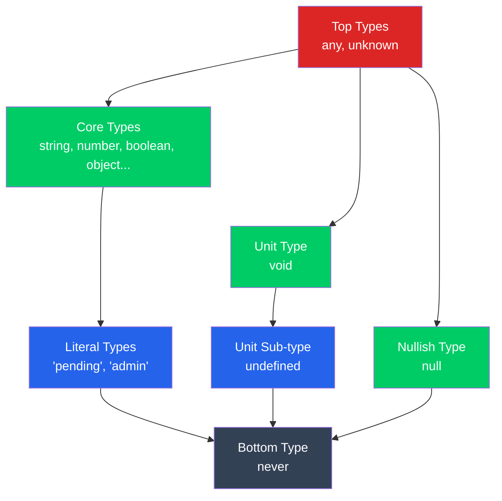

# Understanding TypeScript's Type Hierarchy: any vs unknown vs never

## Introduction

> Imagine receiving data from an API without knowing whether it's a string, number, object, or something else. How do you handle it safely? This is where TypeScript's type system becomes powerful.

Among its many types, `any`, `unknown`, and `never` play particularly interesting roles. They represent different levels of flexibility and type safety. Understanding how they relate to other types will help you write more predictable and maintainable applications.

## 1. Understanding the Type Hierarchy

Before exploring individual types, let's look at how TypeScript
organizes them.

- **Top Types (`any`, `unknown`):** Represent the broadest types that can accommodate values of different types.
- **Core Types:** Include fundamental types such as `string`,`number`, `boolean`, and `object`.
- **Literal Types:** Represent specific values, such as `"pending"`and `"admin"`.
- **Unit Type (`void`):** Represents the absence of a meaningful return value.
- **Unit Sub-type (`undefined`):** Represents an undefined value.
- **Nullish Type (`null`):** Represents an intentional absence of a value.
- **Bottom Type (`never`):** Represents values that can never occur.

### Diagram



_Note: This is a conceptual diagram, not a literal representation of
TypeScript assignability rules._

## 2. Understanding `any`

The `any` type disables normal type checking. You can assign different values and perform operations without compiler errors.

```typescript
let value: any = "Hello";
value = 100;
value.toUpperCase(); // No compiler error
```

However, this can cause runtime errors because TypeScript cannot protect you from invalid operations.

## 3. Understanding `unknown`

The `unknown` type also accepts values of any type, but unlike `any`, it
requires type checking before you can safely use the value.

```typescript
let value: unknown = "Hello";

if (typeof value === "string") {
  console.log(value.toUpperCase());
}
```

This makes `unknown` a safer alternative when handling API responses or external data.

## 4. Understanding `never`

The `never` type represents something that never occurs. It commonly
appears in functions that never return normally.

```typescript
function throwError(message: string): never {
  throw new Error(message);
}
```

It is also useful for exhaustive checking in discriminated unions,
helping identify missing cases during development.

## Conclusion

Understanding `any`, `unknown`, and `never` gives you better control
over TypeScript's type system. Prefer `unknown` when handling uncertain data, avoid unnecessary use of `any`, and use `never` to represent impossible states and enforce exhaustive checks. These concepts are fundamental to writing safer and more reliable TypeScript applications.

**Technical note:** `never` is assignable to every other type, not the other way around. Also, `any` is a special escape hatch rather than an ordinary top type. The diagram is useful for introducing the concepts, but its arrows should not be interpreted as actual assignment directions.
